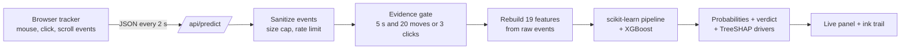
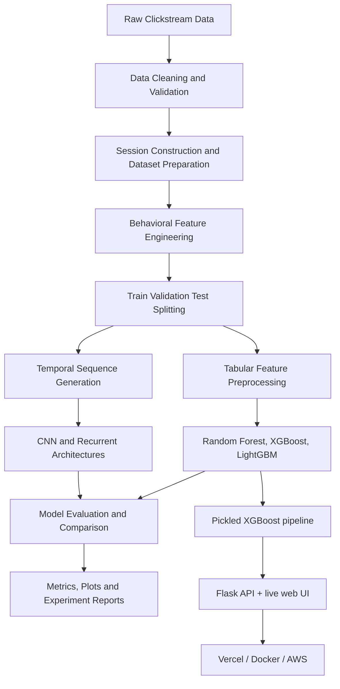

# Clickstream Bot Detector

**Behavioral Bot Detection | Session-Level Classification | Live Web Demo**

[](https://clickstream-bot-detector.vercel.app/)
[](https://www.python.org/)
[](https://flask.palletsprojects.com/)
[](https://xgboost.readthedocs.io/)
[](https://scikit-learn.org/)
[]()

### 🔴 Live demo: **https://clickstream-bot-detector.vercel.app/**

Open the page, move your mouse and click around. A verdict (human / moderate bot / advanced bot) appears within seconds, together with the measurements that drove it. Then press one of the built-in bot scripts and watch the verdict change. Nothing you do on the public demo is stored.

## Contents

- [Overview](#overview)
- [Live demo](#live-demo)
- [Problem statement](#problem-statement)
- [Architecture](#architecture)
- [Dataset](#dataset)
- [Model development](#model-development)
- [Results](#results)
- [Data audit and honest limitations](#data-audit-and-honest-limitations)
- [Deployed model and web app](#deployed-model-and-web-app)
- [Running locally](#running-locally)
- [Deployment](#deployment)
- [Repository structure](#repository-structure)
- [Reproducing the experiments](#reproducing-the-experiments)
- [Future work](#future-work)

## Overview

Automated traffic and fraudulent clicks distort advertising analytics and inflate campaign costs. Telling genuine users from scripts takes more than isolated event rules: it needs behavioral features, timing patterns and context.

This project has two parts:

1. **Research.** A session-level clickstream classification pipeline with four experiment generations (Random Forest, XGBoost, LightGBM, CNN / LSTM / CNN-BiLSTM / attention models) on a 6,000-session, 41-feature dataset.
2. **Product.** The best tabular model (XGBoost) is pickled and served by a Flask app that scores a **live browsing session in real time**, explains each verdict with per-session SHAP values, and is deployed on Vercel (Docker and AWS paths included).

## Live demo

| | |
|---|---|
| URL | https://clickstream-bot-detector.vercel.app/ |
| What it does | Records cursor path, clicks and scrolling in your browser, rebuilds the model's features **on the server** from the raw events, and returns class probabilities. |
| Explanations | Top five measurements pushing the verdict toward or away from the predicted class (TreeSHAP), shown in plain language. |
| Demo scripts | *Click spammer*, *Teleporter* and *Patient bot* drive synthetic mouse events so you can see how the model reacts. |
| Privacy | The public deployment has saving disabled. No IP address, user-agent or cookie is stored. |

How the live pipeline works:



Design choices worth knowing:

- **Server-side feature reconstruction.** The browser sends raw events only. Features are computed in `Model4/deploy/features.py`, a line-for-line port of the training-time converter, and checked for parity (19 of 19 features match).
- **Evidence gate.** No verdict is returned until there are at least 5 seconds of data and 20 mouse moves (or 3 clicks), so the model is never asked to judge an almost-empty session.
- **Low-confidence flag.** Predictions below 70% confidence are shown as "Hard to call" instead of a firm verdict.
- **Training/serving skew guard.** At startup the app compares the saved feature schema with the serving code and refuses to start on a mismatch.
- **Hardening.** Event sanitization, per-client rate limiting, a 4 MB request cap, and `isTrusted` filtering so scripted events never pass as the visitor's own.

## Problem statement

Classify each session into one of three behavioral classes:

| Class | Description |
|---|---|
| `human` | Session representing genuine user activity |
| `moderate_bot` | Session exhibiting moderately automated behavior |
| `advanced_bot` | Session exhibiting more sophisticated automated behavior |

## Architecture



## Technology stack

| Category | Technologies |
|---|---|
| Language | Python 3.13 |
| Data processing | Pandas, NumPy |
| Machine learning | scikit-learn, XGBoost, LightGBM |
| Deep learning | CNN, LSTM, BiLSTM, attention-based architectures |
| Preprocessing | RobustScaler, StandardScaler, OneHotEncoder |
| Explainability | TreeSHAP (XGBoost `pred_contribs`) |
| Web | Flask, gunicorn, vanilla JavaScript, HTML canvas |
| Deployment | Vercel (Python runtime), Docker, AWS ECS Express Mode + ECR |

## Dataset

The project builds on the [TalkingData AdTracking Fraud Detection dataset](https://www.kaggle.com/competitions/talkingdata-adtracking-fraud-detection) as a source of advertising clickstream data, and supports website clickstream exports for real-human sessions.

`data/processed/final_training_dataset_real_human_balanced_advanced.csv`

| Property | Value |
|---|---|
| Samples | 6,000 |
| Features | 41 |
| Classes | 3 (human, moderate bot, advanced bot) |
| Per class | 2,000 each |

| Feature family | Examples |
|---|---|
| Movement statistics | `mouse_speed_mean`, `mouse_speed_std`, `mouse_path_length` |
| Temporal behavior | `request_interval_mean`, `request_interval_std`, `clicks_per_minute` |
| Interaction patterns | `click_burst_score`, `session_idle_ratio`, `trajectory_smoothness` |
| Behavioral complexity | `movement_acceleration`, `mouse_direction_entropy`, `interaction_variability` |
| Contextual metadata | Browser, operating system, device type, country, region |
| Derived indicators | `bot_likelihood_score`, `anomaly_score` |

> The balanced dataset is an experimental training resource, not an estimate of production performance. See the [audit](#data-audit-and-honest-limitations) below for what it does and does not contain.

## Model development

| Experiment | Focus |
|---|---|
| Model 1 | Baseline tabular and deep learning models |
| Model 2 | Improved deep learning architectures, including an enhanced Transformer |
| Model 3 | Targeted high-accuracy CNN-BiLSTM experiment |
| Model 4 | Balanced real-human dataset and improved comparative workflow |

**Tabular models:** Random Forest, XGBoost, LightGBM.
**Deep learning:** CNN, LSTM, CNN-LSTM, CNN-BiLSTM, CNN-Attention-LSTM, run on derived sequences (length 25, 15 features per step, tensor `6000 × 25 × 15`). These are derived from session-level features, not native event traces.

### Experimental setup

| Component | Setting |
|---|---|
| Random seed | 42 |
| Numerical tabular features | `RobustScaler` |
| Categorical features | `OneHotEncoder(handle_unknown="ignore")` |
| Sequence features | `StandardScaler` |
| Optimizer / LR / batch | Adam / 0.001 / 64 |
| Max DL epochs | 30 |
| Tabular split | 80% train, 20% test (stratified) |
| Deep learning split | 70% train, 15% val, 15% test (stratified) |

## Results

### Model 4 research benchmark (all 41 features)

| Model | Accuracy | Precision | Recall | F1 | ROC-AUC |
|---|---:|---:|---:|---:|---:|
| Random Forest | 91.33% | 91.34% | 91.33% | 91.33% | 98.26% |
| **XGBoost** | **92.25%** | **92.26%** | **92.25%** | **92.25%** | **98.32%** |
| LightGBM | 92.08% | 92.09% | 92.08% | 92.08% | 98.26% |
| CNN | 88.56% | 88.57% | 88.56% | 88.55% | 97.01% |
| LSTM | 89.00% | 89.00% | 89.00% | 89.00% | 97.22% |
| CNN-LSTM | 89.00% | 89.01% | 89.00% | 89.00% | 97.12% |
| CNN-BiLSTM | 89.44% | 89.45% | 89.44% | 89.44% | 97.17% |
| CNN-Attention-LSTM | 88.89% | 89.03% | 88.89% | 88.87% | 97.17% |

### Earlier experiments

| Experiment | Best model | Accuracy | F1 | ROC-AUC |
|---|---|---:|---:|---:|
| Model 1 | XGBoost | 89.39% | 89.37% | 98.09% |
| Model 2 | Improved Transformer | 85.70% | 85.71% | 96.68% |
| Model 3 | High-accuracy CNN-BiLSTM | 85.26% | 85.55% | 96.23% |
| Model 4 | XGBoost | 92.25% | 92.25% | 98.32% |

These experiments differ in configuration and (for Model 4) dataset, so this is not a controlled architecture-only comparison.

### Pickled XGBoost variants (what the web app serves)

`Model4/deploy/train_and_pickle.py` trains and saves two variants of the Model 4 XGBoost pipeline:

| Variant | Features | Test accuracy | 5-fold CV accuracy | Notes |
|---|---:|---:|---:|---|
| `reported` | 28 | 92.25% | 91.1% ± 0.8 | Reproduces the benchmark number. Uses features that cannot be rebuilt from a live session. |
| **`clean`** (served) | 19 | 91.25% | 88.98% ± 0.54 | Only behavioral features that can be computed from raw browser events. |

The `clean` model is the one deployed, because it is the only one that can honestly be fed by a live visitor.

## Data audit and honest limitations

Before deploying, the codebase and dataset were audited. The findings matter for how far the 92.25% headline can be trusted, so they are stated here rather than buried.

**What the audit found**

- **Mostly synthetic humans.** Of 2,000 human sessions, only **19 are real captures**. The other 1,981 were generated from those 19 with a Gaussian copula plus donor blending. Some of the 19 came from developer testing inside an Electron-based editor.
- **Simulated bots.** All 4,000 bot sessions come from parametric generators, not from real bot traffic.
- **Metadata shortcut.** `country` and `region` are `"unknown"` for every human row and populated for bots. Together they carried about 75% of XGBoost's feature importance in the original feature set, so the headline accuracy partly measures "is the country field filled in".
- **Label-derived features.** `success_rate` was drawn from label-conditioned distributions, and `bot_likelihood_score` includes it, so the target leaks into the features.
- **Split leakage.** `anomaly_score` (an IsolationForest) was fitted on the full dataset before the train/test split.
- **Redundancy.** `requests_per_minute` duplicates `clicks_per_minute`.

**What was done about it**

- The served `clean` model drops the metadata and label-derived columns and keeps 19 behavioral features that can be reconstructed from raw events. Its accuracy (91.25% test, 88.98% CV) is close to the reported figure, which indicates that the behavioral signal is real within this data.
- The live pipeline is validated for feature parity with the training converter (19 of 19).

**What remains true**

- Accuracy is measured against *simulated* bots and *synthetic* humans. It says how well the model separates this dataset's classes, not how well it catches real-world fraud.
- The `clean` model is largely a **scale detector**: `mouse_path_length` (about 28%), `session_duration_sec` (about 19%) and `click_burst_score` (about 13%) dominate. It is strongest against bots that look like the simulated ones.
- **Known blind spot:** a script that moves smoothly over a long distance and clicks slowly can look human. The demo's "Patient bot" exists to probe exactly this.
- The balanced 1:1:1 class mix does not reflect real traffic prevalence, and probabilities are not calibrated.
- Treat the demo as a demonstration of the end-to-end pipeline, not as a production fraud decision engine.

## Deployed model and web app

```text
Model4/deploy/
├── train_and_pickle.py      # trains + pickles the reported and clean variants
├── features.py              # raw events -> model features (port of the training converter)
├── verify_features.py       # parity checks + bot/human scenario probe
└── artifacts/
    ├── clean/               # served: pipeline.joblib, xgb_model.json,
    │                        #         feature_schema.json, model_card.json
    └── reported/            # 28-feature variant (benchmark reproduction)

webapp/
├── app.py                   # Flask app factory: /, /health, /api/model, /api/predict, /api/save
├── storage.py               # optional JSON-file session store (off on the public demo)
├── templates/index.html
├── tests/test_app.py        # API tests
└── tools/bot_demo.py        # Playwright driver for scripted browser checks

public/static/               # style.css, tracker.js, trace.js, bots.js, ui.js (served from the CDN on Vercel)
wsgi.py                      # Vercel entrypoint
```

API summary:

| Route | Method | Purpose |
|---|---|---|
| `/` | GET | The interactive page |
| `/health` | GET | Liveness check and model variant |
| `/api/model` | GET | Model metadata, feature list, caveats |
| `/api/predict` | POST | Raw session events in; probabilities, verdict and top drivers out |
| `/api/save` | POST | Optional consented session save (disabled when `SAVE_ENABLED=0`) |

Environment variables: `MODEL_DIR`, `STORE_DIR`, `SAVE_ENABLED` (default `1` locally, `0` on Vercel via `wsgi.py`), `COLLECT_TOKEN`, `RATE_LIMIT`.

## Running locally

```bash
git clone https://github.com/stackbyaditya/Talking-Ad-Data-for-Click-Stream.git
cd Talking-Ad-Data-for-Click-Stream
python -m venv .venv
```

Activate the environment (`.venv\Scripts\activate` on Windows, `source .venv/bin/activate` on macOS/Linux), then install:

```bash
pip install flask scikit-learn xgboost numpy pandas joblib
```

> The root `requirements.txt` is written for **deployment** (it uses `xgboost-cpu` to fit Vercel's size limit). For local research and training, keep your normal environment with the full `xgboost` package rather than installing that file over it.

Run the web app:

```bash
python webapp/app.py
```

Then open http://127.0.0.1:5000. Run the tests:

```bash
python -m pytest webapp/tests
```

Retrain and re-pickle the models (needs the dataset in `data/processed/`):

```bash
python Model4/deploy/train_and_pickle.py
python Model4/deploy/verify_features.py
```

## Deployment

### Vercel (current live deployment)

The repo is connected to a Vercel project, so **every push to the production branch redeploys automatically**, and pushes to other branches create preview deployments. Configuration lives in `vercel.json`, `.python-version` (3.13), `wsgi.py` and the root `requirements.txt`.

Notes specific to Vercel's Python runtime: the filesystem is read-only (so saving is off), the bundle is limited to 500 MB (hence `xgboost-cpu`, about 4.5 MB instead of about 224 MB), and `vercel.json` excludes research folders from the function bundle.

### Docker

```bash
docker build -t clickstream-bot-detector .
docker run -p 8080:8080 clickstream-bot-detector
```

The image is `python:3.13-slim` running gunicorn on port 8080, with saving disabled.

### AWS

`DEPLOY.md` walks through pushing the image to ECR and running it on ECS Express Mode.

## Repository structure

```text
.
├── Model1/                  # Baseline experiments
├── Model2/                  # Improved deep learning experiments
├── Model3/                  # Specialized CNN-BiLSTM experiment
├── Model4/                  # Balanced real-human experiment
│   ├── models/
│   ├── outputs/
│   ├── reports/
│   └── deploy/              # Pickling, feature port, artifacts
├── webapp/                  # Flask app, templates, tests
├── public/static/           # Frontend JS and CSS
├── data/processed/          # Prepared training datasets
├── preprocessing/           # Shared preprocessing utilities
├── scripts/                 # Dataset construction and conversion
├── artifacts/               # Shared preprocessing artifacts
├── model_outputs/           # Shared and legacy outputs
├── reports/                 # Supporting reports
├── wsgi.py                  # Vercel entrypoint
├── vercel.json              # Vercel function config
├── Dockerfile               # Container image
├── DEPLOY.md                # AWS deployment guide
├── requirements.txt         # Deployment dependencies
├── RESULTS                  # Experiment result summary
├── CONTEXT.md               # Project context and notes
└── README.md
```

## Reproducing the experiments

Regenerate the dataset from raw clickstream input (the input files must be available locally):

```bash
python scripts/convert_clickstream_json_to_training_csv.py --input data/clickstream_20260318_235610.json --output data/processed/clickstream_20260318_235610_advanced.csv
python scripts/build_balanced_dataset_from_real_humans.py
```

Run Model 4:

```bash
python Model4/models/run_model4_experiment.py
python Model4/models/run_model4_experiment.py --skip-dl
python Model4/models/run_model4_experiment.py --dl-epochs 20 --dl-batch-size 64
```

Key outputs: `Model4/outputs/combined_model_performance.json`, `Model4/outputs/sequence_artifacts/`, `Model4/reports/model4_experiment_summary.md`. See also [Model 4 documentation](Model4/README.md), [RESULTS](RESULTS) and [CONTEXT.md](CONTEXT.md).

## Future work

- Collect real bot traffic and many more real human sessions; retrain and re-evaluate on data that is not simulated.
- Fix the dataset artifacts above at the source (metadata shortcut, label-derived features, pre-split fitting) and report results on a held-out set of real sessions.
- Add features that separate smooth, slow bots from humans (micro-jitter, velocity profiles, scroll-reading patterns), and use native event sequences instead of derived ones.
- Calibrate probabilities and evaluate precision-recall under realistic class imbalance.
- Add drift monitoring and periodic retraining, and a persistent data store for consented sessions.

---

**Live demo:** [clickstream-bot-detector.vercel.app](https://clickstream-bot-detector.vercel.app/) · **Repository:** [Talking-Ad-Data-for-Click-Stream](https://github.com/stackbyaditya/Talking-Ad-Data-for-Click-Stream)
