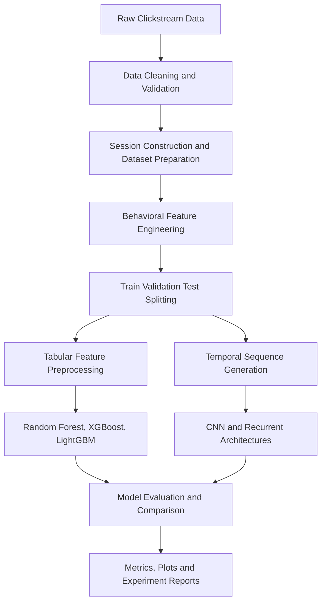

# Clickstream Fraud Detection Using Machine Learning & Deep Learning

**Behavioral Bot Detection | Session-Level Classification | Comparative Model Evaluation**

[](https://www.python.org/)
[](https://scikit-learn.org/)
[](https://xgboost.readthedocs.io/)
[]()

## Overview

Automated traffic and fraudulent clicks can distort advertising analytics, inflate campaign costs, and undermine the reliability of digital advertising platforms. Distinguishing genuine user activity from automated behavior requires more than isolated event-level rules; it calls for a combination of behavioral features, temporal patterns, and contextual signals.

This project develops a **machine learning and deep learning pipeline for session-level clickstream classification**. It combines clickstream data preparation, behavioral feature engineering, tabular classification, sequence-based modeling, and comparative evaluation to distinguish human sessions from moderate and advanced bot activity.

The repository contains four experiment generations, progressing from baseline models to an improved workflow trained on a balanced dataset incorporating real-human clickstream sessions.

## Problem Statement

The objective is to classify each session into one of three behavioral categories:

| Class | Description |
|---|---|
| `human` | Session representing genuine user activity |
| `moderate_bot` | Session exhibiting moderately automated behavior |
| `advanced_bot` | Session exhibiting more sophisticated automated behavior |

The task is formulated as a **three-class classification problem**. The goal is to evaluate whether engineered session-level signals can distinguish genuine behavior from increasingly sophisticated automated traffic.

## Key Features

- **Clickstream preprocessing:** Transform raw clickstream records and website interaction exports into structured datasets.
- **Behavioral feature engineering:** Construct statistical, temporal, contextual, and interaction-derived features.
- **Balanced dataset construction:** Develop a three-class training dataset containing real-human sessions alongside moderate- and advanced-bot samples.
- **Tabular machine learning:** Benchmark Random Forest, XGBoost, and LightGBM.
- **Deep learning:** Evaluate CNN, LSTM, CNN-LSTM, CNN-BiLSTM, and CNN-Attention-LSTM architectures.
- **Experiment comparison:** Compare model generations using accuracy, precision, recall, F1 score, and ROC-AUC.
- **Reproducible artifacts:** Organize experiment-specific outputs, evaluation reports, and sequence-generation artifacts.

## Technology Stack

| Category | Technologies |
|---|---|
| Language | Python |
| Data processing | Pandas, NumPy |
| Machine learning | Scikit-learn |
| Gradient boosting | XGBoost, LightGBM |
| Deep learning | CNN, LSTM, BiLSTM, attention-based architectures |
| Preprocessing | RobustScaler, StandardScaler, OneHotEncoder |
| Evaluation | Precision, recall, F1 score, ROC-AUC, confusion matrices |
| Visualization | Matplotlib and other experiment-specific plotting utilities |

## System Architecture

The project follows a modular pipeline from raw data to model evaluation.



### Pipeline stages

1. **Data preparation:** Convert supported clickstream inputs into structured records and prepare session-level datasets.
2. **Feature engineering:** Extract behavioral descriptors, request timing statistics, session activity measures, and contextual metadata.
3. **Preprocessing:** Handle missing values, remove duplicates where necessary, scale numerical features, and encode categorical variables.
4. **Model training:** Train tabular classifiers and deep learning architectures using their respective feature representations.
5. **Evaluation:** Measure classification performance and generate comparative reports and visualizations.

## Dataset

The project uses the [TalkingData AdTracking Fraud Detection dataset](https://www.kaggle.com/competitions/talkingdata-adtracking-fraud-detection) as a source of advertising clickstream data. It also supports website clickstream exports for incorporating real-human behavioral sessions.

### Primary training dataset

The current Model 4 workflow uses:

`data/processed/final_training_dataset_real_human_balanced_advanced.csv`

| Property | Value |
|---|---|
| Samples | 6,000 |
| Features | 41 |
| Number of classes | 3 |
| Human sessions | 2,000 |
| Moderate-bot samples | 2,000 |
| Advanced-bot samples | 2,000 |

The dataset is balanced across the three classes to support controlled model comparison.

### Feature engineering

The advanced feature set includes several categories of behavioral information:

| Feature family | Examples |
|---|---|
| Movement statistics | `mouse_speed_mean`, `mouse_speed_std`, `mouse_path_length` |
| Temporal behavior | `request_interval_mean`, `request_interval_std`, `clicks_per_minute` |
| Interaction patterns | `click_burst_score`, `session_idle_ratio`, `trajectory_smoothness` |
| Behavioral complexity | `movement_acceleration`, `mouse_direction_entropy`, `interaction_variability` |
| Contextual metadata | Browser, operating system, device type, country, region |
| Derived indicators | `bot_likelihood_score`, `anomaly_score` |

These features are designed to represent differences in interaction consistency, timing, variability, and session context.

**Data interpretation:** The balanced dataset is an experimental training resource. Its results should not be interpreted as a direct estimate of production performance on naturally occurring traffic, where class distributions and behavioral patterns may differ.

## Model Development

The repository organizes experiments into four generations.

| Experiment | Focus |
|---|---|
| Model 1 | Baseline tabular and deep learning models |
| Model 2 | Improved deep learning architectures, including an enhanced Transformer experiment |
| Model 3 | Targeted high-accuracy CNN-BiLSTM experiment |
| Model 4 | Balanced real-human dataset and an improved comparative workflow |

### Tabular machine learning

Three tree-based models are evaluated:

- **Random Forest:** An ensemble of decision trees for learning nonlinear relationships between behavioral features.
- **XGBoost:** Gradient-boosted trees for learning complex feature interactions and producing strong tabular classification performance.
- **LightGBM:** A gradient-boosting framework used as a computationally efficient comparison against XGBoost.

### Deep learning

The evaluated architectures include:

- **CNN:** Learns local patterns in the generated feature sequences.
- **LSTM:** Models sequential dependencies.
- **CNN-LSTM:** Combines convolutional feature extraction with recurrent sequence learning.
- **CNN-BiLSTM:** Captures sequence dependencies in both directions.
- **CNN-Attention-LSTM:** Incorporates attention into a convolutional and recurrent architecture.

Model 2 also includes an improved Transformer experiment, while Model 3 includes a specialized CNN-BiLSTM experiment.

### Sequence representation

For the Model 4 deep learning workflow, the project generates fixed-length sequences from session-level features.

| Property | Configuration |
|---|---|
| Sequence length | 25 |
| Features per timestep | 15 |
| Total sequence tensor shape | `6000 × 25 × 15` |

Sequence generation enables temporal architectures to operate on structured session representations. These are derived sequences rather than native, uninterrupted event-level interaction traces.

## Experimental Setup

The documented shared configuration includes:

| Component | Setting |
|---|---|
| Random seed | 42 |
| Numerical tabular features | `RobustScaler` |
| Categorical features | `OneHotEncoder(handle_unknown="ignore")` |
| Sequence features | `StandardScaler` |
| Optimizer | Adam |
| Learning rate | 0.001 |
| Batch size | 64 |
| Maximum deep learning epochs | 30 |

The documented evaluation splits are stratified:

- Tabular models: 80% training and 20% testing.
- Deep learning models: 70% training, 15% validation, and 15% testing.

The split strategy and preprocessing are implemented within the respective experiment workflows. Results should be compared using their documented evaluation settings.

## Results

### Model 4 — Primary benchmark

Model 4 uses the balanced real-human dataset and achieves the strongest reported overall accuracy among the documented experiments.

#### Tabular models

| Model | Accuracy | Precision | Recall | F1 score | ROC-AUC |
|---|---:|---:|---:|---:|---:|
| Random Forest | 91.33% | 91.34% | 91.33% | 91.33% | 98.26% |
| **XGBoost** | **92.25%** | **92.26%** | **92.25%** | **92.25%** | **98.32%** |
| LightGBM | 92.08% | 92.09% | 92.08% | 92.08% | 98.26% |

#### Deep learning models

| Model | Accuracy | Precision | Recall | F1 score | ROC-AUC |
|---|---:|---:|---:|---:|---:|
| CNN | 88.56% | 88.57% | 88.56% | 88.55% | 97.01% |
| LSTM | 89.00% | 89.00% | 89.00% | 89.00% | 97.22% |
| CNN-LSTM | 89.00% | 89.01% | 89.00% | 89.00% | 97.12% |
| CNN-BiLSTM | 89.44% | 89.45% | 89.44% | 89.44% | 97.17% |
| CNN-Attention-LSTM | 88.89% | 89.03% | 88.89% | 88.87% | 97.17% |

*Results are from the repository's documented experiments and are not independently reproduced by this README.*

### Earlier experiment comparison

| Experiment | Best documented model | Accuracy | F1 score | ROC-AUC |
|---|---|---:|---:|---:|
| Model 1 | XGBoost | 89.39% | 89.37% | 98.09% |
| Model 2 | Improved Transformer | 85.70% | 85.71% | 96.68% |
| Model 3 | High-accuracy CNN-BiLSTM | 85.26% | 85.55% | 96.23% |
| Model 4 | XGBoost | **92.25%** | **92.25%** | **98.32%** |

The experiments use different model configurations and, in Model 4, an improved dataset. This table summarizes the recorded results; it should not be interpreted as a perfectly controlled architecture-only comparison.

### Key findings

1. XGBoost delivers the strongest reported accuracy among the evaluated models in Model 4.
2. LightGBM provides competitive performance, while Random Forest serves as a useful ensemble baseline.
3. The best documented deep learning model in Model 4 is CNN-BiLSTM, with 89.44% accuracy.
4. The Model 4 workflow improves on the Model 1 XGBoost baseline in the reported benchmark.
5. Dataset construction, feature quality, and experimental design are important factors alongside model architecture.

## Evaluation Metrics

The project evaluates classification performance using:

- **Accuracy:** Fraction of correctly classified samples.
- **Precision:** Proportion of predicted class assignments that are correct.
- **Recall:** Proportion of actual class instances correctly identified.
- **F1 score:** Harmonic mean of precision and recall.
- **ROC-AUC:** Measures class-discrimination ability using a one-vs-rest approach for multiclass evaluation.

Supporting outputs include confusion matrices, ROC curves, feature-importance plots for boosting models, training curves for deep learning models, and model-comparison visualizations.

## Repository Structure

```text
.
├── Model1/                  # Baseline experiments
├── Model2/                  # Improved deep learning experiments
├── Model3/                  # Specialized CNN-BiLSTM experiment
├── Model4/                  # Balanced real-human experiment
│   ├── models/
│   ├── outputs/
│   └── reports/
├── data/
│   └── processed/           # Prepared training datasets
├── preprocessing/           # Shared preprocessing utilities
├── scripts/                 # Dataset construction and conversion
├── artifacts/               # Shared preprocessing artifacts
├── model_outputs/            # Shared and legacy outputs
├── reports/                  # Supporting reports
├── RESULTS                  # Experiment result summary
├── CONTEXT.md               # Project context and notes
└── README.md                # Project documentation
```

Some generated datasets and artifacts may be local or experiment-specific. Consult the actual repository contents and `.gitignore` when determining which files are tracked.

## Getting Started

### 1. Clone the repository

```bash
git clone https://github.com/stackbyaditya/Talking-Ad-Data-for-Click-Stream.git
cd Talking-Ad-Data-for-Click-Stream
```

### 2. Set up a Python environment

Create and activate a virtual environment:

```bash
python -m venv .venv
```

On Windows:

```bash
.venv\Scripts\activate
```

On macOS or Linux:

```bash
source .venv/bin/activate
```

Install the dependencies specified by the project. If a root-level `requirements.txt` is available:

```bash
pip install -r requirements.txt
```

Otherwise, consult the experiment-specific dependency files and install the required packages for the workflow you intend to run.

### 3. Prepare the dataset

The Model 4 workflow uses the balanced advanced dataset described above. If you need to regenerate the dataset from the supported raw clickstream input, the documented commands are:

```bash
python scripts/convert_clickstream_json_to_training_csv.py --input data/clickstream_20260318_235610.json --output data/processed/clickstream_20260318_235610_advanced.csv
python scripts/build_balanced_dataset_from_real_humans.py
```

Ensure the required input files are available locally before executing these commands.

### 4. Run Model 4

Run the documented end-to-end experiment:

```bash
python Model4/models/run_model4_experiment.py
```

To skip deep learning:

```bash
python Model4/models/run_model4_experiment.py --skip-dl
```

To configure the deep learning run:

```bash
python Model4/models/run_model4_experiment.py --dl-epochs 20 --dl-batch-size 64
```

Check the experiment script's available arguments and the relevant model README if your local version differs.

## Outputs and Reports

The primary Model 4 artifacts documented by the project include:

- `Model4/outputs/combined_model_performance.json` — combined model performance metrics.
- `Model4/outputs/sequence_artifacts/model4_sequence_dataset.npz` — generated sequence dataset.
- `Model4/outputs/sequence_artifacts/model4_sequence_metadata.json` — sequence metadata.
- `Model4/reports/model4_experiment_summary.md` — experiment summary.

For additional experiment details, see:

- [Model 4 documentation](Model4/README.md)
- [Experiment results](RESULTS)
- [Project context](CONTEXT.md)

## Limitations

- The balanced training dataset does not reflect the natural prevalence of fraudulent traffic in every deployment setting.
- Some bot samples and behavioral descriptors are constructed or derived for experimentation rather than collected from a representative live production environment.
- The sequence-based models use generated representations of session-level features, not necessarily complete raw event timelines.
- Synthetic or heuristic features can introduce assumptions that affect generalization.
- Reported benchmark performance does not guarantee equivalent performance on unseen websites, traffic sources, or evolving bot strategies.

## Future Work

Potential extensions include:

- Training and evaluation on larger, independently collected real-human and real-bot datasets.
- Using native event-level interaction sequences instead of generated session representations.
- Evaluating robustness across websites, devices, and traffic distributions.
- Calibrating model probabilities and evaluating precision-recall trade-offs under realistic class imbalance.
- Investigating drift detection and periodic retraining for changing automated traffic patterns.
- Evaluating inference latency and resource requirements for deployment scenarios.

## Conclusion

This project explores a comparative approach to clickstream-based bot detection by combining behavioral feature engineering with classical machine learning and deep learning architectures.

The documented Model 4 experiment reports **92.25% accuracy with XGBoost** on the project's balanced three-class benchmark. The results highlight the importance of data preparation and engineered session features, while the documented limitations emphasize the need for further evaluation on representative real-world traffic.

The repository is intended as a research and development project for studying behavioral classification, model comparison, and reproducible experimentation.

---

**Repository:** [Talking-Ad-Data-for-Click-Stream](https://github.com/stackbyaditya/Talking-Ad-Data-for-Click-Stream)
